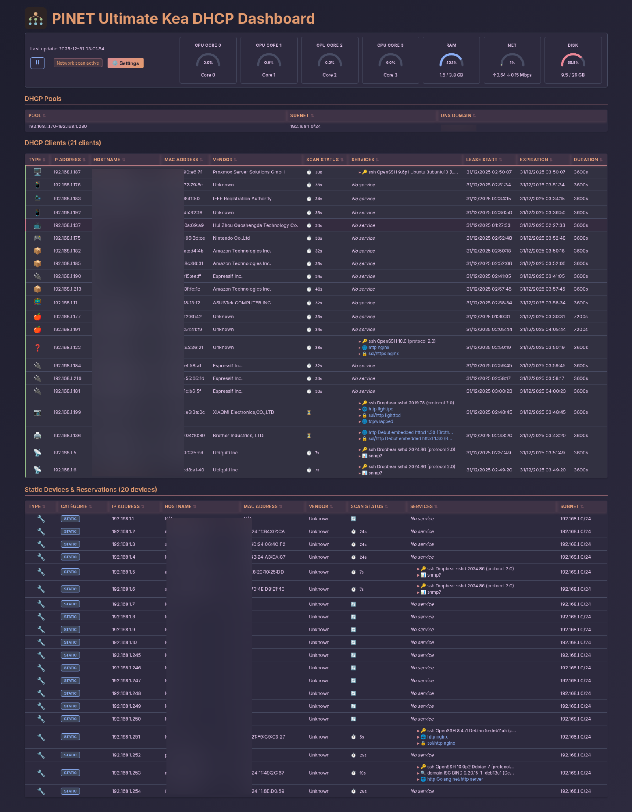

# Ultimate Kea DHCP Dashboard

> [!IMPORTANT]
> Ce projet est archivé et n'est plus maintenu. Il est remplacé par [Pelagos](https://github.com/NeySlim/pelagos), un DDI auto-hébergé pour BIND 9 et ISC Kea (DNS, DHCP, DDNS) avec interface web.

> **Langues / Languages:** [🇬🇧 English](README.md) | [🇫🇷 Français](README.fr.md)

---

Un tableau de bord web moderne pour serveur ISC Kea DHCP avec découverte réseau avancée, surveillance SNMP et métriques système.



## Fonctionnalités Principales

- **Surveillance DHCP**: Suivi des baux en temps réel, utilisation des pools, identification vendeur MAC (IEEE OUI)
- **Découverte Réseau**: Scan multi-threadé, détection services (SSH/HTTP/SNMP), identification type d'appareil
- **Intégration SNMP**: Découverte informations système (sysDescr, sysContact, sysLocation, sysUpTime), communautés configurables
- **Métriques Système**: Surveillance CPU/RAM/Réseau/Disque en temps réel avec jauges réactives
- **Interface Moderne**: 7 thèmes (Ember, Twilight, Frost, Blossom, Clarity, Pulse, Vicuna), 5 langues, design réactif
- **Mise à Jour Auto**: Vérificateur de mises à jour intégré avec installation en un clic

## Installation

### Installateur Automatisé (Recommandé)

```bash
curl -sL https://github.com/NeySlim/ultimate-kea-dhcp-dashboard/releases/latest/download/ultimate-kea-dashboard-installer.sh -o installer.sh
sudo bash installer.sh
```

### Paquets par Distribution

Téléchargez `.deb`, `.rpm`, ou `.pkg.tar.zst` depuis les [releases](https://github.com/NeySlim/ultimate-kea-dhcp-dashboard/releases):

```bash
# Debian/Ubuntu
sudo dpkg -i ultimate-kea-dashboard_*.deb && sudo apt-get install -f

# Fedora/RHEL
sudo dnf install ultimate-kea-dashboard-*.rpm

# Arch Linux
sudo pacman -U ultimate-kea-dashboard-*.pkg.tar.zst
```

### Installation Manuelle

```bash
git clone https://github.com/NeySlim/ultimate-kea-dhcp-dashboard.git
cd ultimate-kea-dhcp-dashboard
sudo bash install.sh
```

**Dépendances**: Python 3.8+, ISC Kea, nmap, arping, net-tools, python3-psutil. Optionnel: snmp, avahi-utils.

## Configuration

Éditez `/opt/ukd/etc/ultimate-kea-dashboard.conf`:

```ini
[DEFAULT]
port = 8089
ssl_enabled = true
kea_socket = /run/kea/kea4-ctrl-socket
scan_threads = 50
snmp_enabled = true
snmp_communities = public,home
```

Configuration automatiquement récupérée depuis Kea via socket de contrôle—aucune configuration manuelle subnet/pool requise!

## Utilisation

Accès à `https://votre-serveur:8089` (ou HTTP si SSL désactivé)

- **Paramètres**: Configurer intervalles de rafraîchissement, thèmes, langues
- **Contrôle Scan**: Pause/reprise de la découverte réseau
- **Mise à Jour Auto**: Vérificateur de mises à jour avec installation en un clic

## Documentation

- [Guides d'Installation](docs/) - Instructions spécifiques par distribution
- [Dépendances](docs/DEPENDENCIES.fr.md) - Liste complète des dépendances
- [Thèmes](THEME.md) - Personnalisation des thèmes
- [SNMP](SNMP-FEATURE.md) - Configuration SNMP

## Licence

Licence MIT - Voir [LICENSE](LICENSE) pour les détails.

## Liens

- [Changelog](CHANGELOG.md)
- [Contribution](CONTRIBUTING.md)
- [Sécurité](SECURITY.md)
# Télécharger et exécuter l'installateur
curl -sL https://raw.githubusercontent.com/username/ultimate-kea-dhcp-dashboard/main/install.sh -o install.sh
sudo bash install.sh
```

## Installation Manuelle

1. Cloner le dépôt :
```bash
git clone https://github.com/username/ultimate-kea-dashboard.git
cd ultimate-kea-dashboard
```

2. Installer les dépendances (spécifique à chaque distribution) :

**Debian/Ubuntu:**
```bash
sudo apt-get update
sudo apt-get install -y python3 python3-pip nmap arping net-tools python3-psutil
# Optionnel pour fonctionnalités avancées:
sudo apt-get install -y snmp avahi-utils
```

**Fedora/RHEL/CentOS:**
```bash
sudo dnf install -y nmap iputils python3 python3-pip net-tools python3-psutil
# Optionnel pour fonctionnalités avancées:
sudo dnf install -y net-snmp-utils avahi-tools
```

**Arch/Manjaro:**
```bash
sudo pacman -S nmap iputils python python-pip net-tools python-psutil
# Optionnel pour fonctionnalités avancées:
sudo pacman -S net-snmp avahi
sudo systemctl enable --now avahi-daemon
```

**openSUSE:**
```bash
sudo zypper install nmap iputils python3 python3-pip net-tools python3-psutil
# Optionnel pour fonctionnalités avancées:
sudo zypper install net-snmp avahi-utils
```

**Note**: 
- **psutil** est installé via le gestionnaire de paquets système (méthode recommandée)
- Utiliser les paquets système évite les conflits avec pip et respecte PEP 668
- Les paquets optionnels activent les requêtes SNMP et la découverte mDNS
- Voir [Dépendances](docs/DEPENDENCIES.fr.md) pour plus de détails

3. Configurer le tableau de bord :
```bash
sudo cp etc/ultimate-dashboard.conf.example etc/ultimate-dashboard.conf
sudo nano etc/ultimate-dashboard.conf
```

4. Exécuter le tableau de bord :
```bash
sudo python3 bin/ultimate-dashboard
```

Ou installer en tant que service systemd :
```bash
sudo ./install.sh
```

## Configuration

Modifier `/etc/ultimate-dashboard/ultimate-dashboard.conf`:

```ini
[DEFAULT]
# Paramètres serveur
port = 8089
ssl_enabled = true

# Intégration Kea (simplifié - pas besoin de configuration manuelle subnet/pool!)
kea_config = /etc/kea/kea-dhcp4.conf
kea_socket = /run/kea/kea4-ctrl-socket

# Scan
scan_threads = 50
scan_timeout = 0.5

# Découverte SNMP (optionnel)
snmp_enabled = true
snmp_communities = public,home
snmp_timeout = 1
```

**Améliorations Clés:**
- **Configuration Automatique**: Les informations de subnet, pool et plage DHCP sont automatiquement récupérées depuis Kea via le socket de contrôle
- **Aucune duplication**: Plus besoin de maintenir les paramètres réseau dans deux fichiers de configuration
- **Simplifié**: Pointez juste vers le fichier de configuration Kea et le socket - le tableau de bord fait le reste!

## Utilisation

### Service Systemd (Installation Recommandée)

```bash
# Démarrer le service
sudo systemctl start ultimate-dashboard

# Activer au démarrage
sudo systemctl enable ultimate-dashboard

# Vérifier le statut
sudo systemctl status ultimate-dashboard

# Voir les logs
sudo journalctl -u ultimate-dashboard -f
```

### Exécution Manuelle (Développement)

```bash
sudo python3 bin/ultimate-dashboard
```

### Accès au Tableau de Bord

Ouvrez votre navigateur et naviguez vers :
- **HTTP**: `http://votre-serveur:8089`
- **HTTPS**: `https://votre-serveur:8089` (si SSL activé)

## Documentation

- [Distributions Supportées](docs/DISTRIBUTIONS.fr.md) - Matrice de compatibilité complète
- [Guide des Dépendances](docs/DEPENDENCIES.fr.md) - Dépendances détaillées
- [Installation Fedora/RHEL](docs/INSTALL-FEDORA.fr.md) - Guide spécifique Fedora/CentOS
- [Installation Arch](docs/INSTALL-ARCH.fr.md) - Guide spécifique Arch Linux
- [Guide Développeur Multi-Distro](docs/MULTI-DISTRO-DEV.fr.md) - Ajouter des distributions
- [PEP 668 et Paquets Python](docs/PEP668-PYTHON-PACKAGES.fr.md) - Bonnes pratiques

## Architecture

- **Backend**: Python 3.8+ avec bibliothèques standard
- **Frontend**: HTML5, CSS3, JavaScript vanilla
- **Intégration Kea**: Socket de contrôle + fichier de baux en fallback
- **Scan Réseau**: nmap, arping
- **Métriques Système**: psutil
- **Visualisation**: SVG, Canvas, graphiques dynamiques

## Fonctionnalités

- ✅ Surveillance DHCP en temps réel
- ✅ Configuration automatique depuis Kea
- ✅ Scan réseau multi-threadé
- ✅ Détection avancée des appareils
- ✅ Métriques système en direct
- ✅ 6 thèmes professionnels
- ✅ Support multi-langue
- ✅ Compatible 15+ distributions Linux
- ✅ Installateur automatique
- ✅ Service systemd
- ✅ Dégradation gracieuse

## Sécurité

- Exécution requise en tant que root pour le scan réseau
- Support SSL/TLS
- Contextes SELinux/AppArmor configurables
- Pas d'authentification par défaut (recommandé derrière reverse proxy)
- Communauté SNMP configurable
- Timeouts configurables pour éviter les scans excessifs

## Dépannage

### Le service ne démarre pas

```bash
# Vérifier les logs
sudo journalctl -u ultimate-dashboard -n 50

# Vérifier la configuration
sudo nano /etc/ultimate-dashboard/ultimate-dashboard.conf

# Tester manuellement
sudo python3 /opt/ukd/bin/ultimate-dashboard
```

### Pas de baux affichés

1. Vérifier que Kea fonctionne : `sudo systemctl status kea-dhcp4`
2. Vérifier le socket de contrôle : `ls -la /run/kea/kea4-ctrl-socket`
3. Vérifier les permissions du fichier de baux : `ls -la /var/lib/kea/kea-leases4.csv`

### Métriques système ne fonctionnent pas

```bash
# Vérifier psutil
python3 -c "import psutil; print(psutil.__version__)"

# Installer si manquant (via packages système)
# Debian/Ubuntu
sudo apt install python3-psutil

# Fedora/RHEL
sudo dnf install python3-psutil

# Arch
sudo pacman -S python-psutil
```

## Contribution

Les contributions sont les bienvenues ! Consultez [CONTRIBUTING.md](CONTRIBUTING.md) pour les directives.

1. Fork le projet
2. Créer votre branche de fonctionnalité (`git checkout -b feature/AmazingFeature`)
3. Commit vos changements (`git commit -m 'Add some AmazingFeature'`)
4. Push vers la branche (`git push origin feature/AmazingFeature`)
5. Ouvrir une Pull Request

## License

Ce projet est sous licence MIT - voir le fichier [LICENSE](LICENSE) pour les détails.

## Auteur

**username**

## Remerciements

- ISC pour Kea DHCP Server
- Communauté Python
- Contributeurs Open Source
- Utilisateurs pour leurs retours et suggestions

## Changelog

Voir [CHANGELOG.md](CHANGELOG.md) pour l'historique détaillé des versions.

## Support

- 📝 [Documentation](docs/)
- 🐛 [Issues](https://github.com/username/ultimate-kea-dashboard/issues)
- 💬 [Discussions](https://github.com/username/ultimate-kea-dashboard/discussions)

---

**Installable en une commande sur 15+ distributions Linux !** 🚀

```bash
curl -sL https://raw.githubusercontent.com/username/ultimate-kea-dhcp-dashboard/main/install.sh | sudo bash
```
